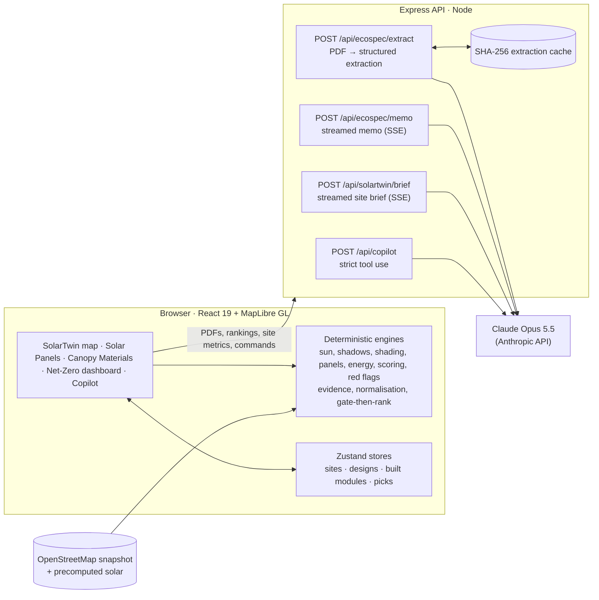

# TerraTwin AI 3D: the Net-Zero Township Copilot

> **Where should a township build solar, and what should it build it with?**
> TerraTwin answers both on a live 3D digital twin: it screens every real rooftop, car park and home for solar, then reads supplier documents to pick verified low-carbon panels and materials, and builds the choice on the map.


Built for the **PLANET hackathon** challenge on **City of Elmina** (Sime Darby Property, Shah Alam).

**Contents:** [The problem](#the-problem) · [What it does](#what-it-does) · [At a glance](#at-a-glance) · [Demo](#the-guided-demo) · [Architecture](#architecture) · [Tech stack](#tech-stack) · [How we use AI](#how-we-use-ai) · [Run it](#run-it) · [How it works](#how-it-works) · [Testing](#testing-and-quality) · [Repo structure](#repo-structure) · [Data and honesty notes](#data-and-honesty-notes) · [Roadmap](#roadmap)

## The problem

Sime Darby Property's **SSR2030** goal is to cut emissions **40% by 2030**. For a township that means two kinds of carbon:

- **Operational carbon**, the electricity buildings use. Solar is the biggest lever, but deciding *which* of thousands of roofs, car parks and homes to equip means judging usable area, shading, daytime demand, grid limits and engineering readiness site by site.
- **Embodied carbon**, in the materials used to build. Procurement teams compare supplier PDFs full of specs, prices and green claims, and many of those claims ("carbon-neutral", "eco-friendly") have no certificate behind them.

Both decisions are slow, manual and hard to audit. TerraTwin turns them into one visual, evidence-backed workflow.

## What it does

A live 3D digital twin that joins four modules into one story:

| Module | Carbon | What it does |
|---|---|---|
| **SolarTwin** | Operational | Ranks 262 rooftops, 9 car parks and 1,821 landed-home rows (≈6,900 homes) by usable area, shading loss and daytime demand match. It flags missing data and engineering checks, designs solar carports, and shows residents their CREAM roof-lease income. |
| **Solar Panels** | Both | Runs the supplier-document pipeline below on PV module datasheets: gates on efficiency, heat tolerance and degradation, scores each eligible module out of 100 on carbon cut, extra cost and efficiency, and builds the top-scoring module on the SolarTwin site, re-sizing its kWp, yield and CAPEX. |
| **Canopy Materials** | Embodied | Reads car-park canopy supplier PDFs (footing concrete, pavers) with Claude: specs, prices, EPDs, certificates and every green claim, each with its verbatim quote and page. It gates by performance, flags greenwashing, normalises carbon to the functional unit, recommends the top-scoring verified option (carbon cut, extra cost and strength), and builds the chosen footings and paving into the canopy. |
| **Net-Zero dashboard** | Both | Rolls the chosen sites and materials into SSR2030 progress, IFRS S2-style metrics and a printable decision pack. |

**Highlights**

- 🛰️ **A real township in 3D:** 2,188 OpenStreetMap buildings, coloured by solar score, with live sun, shadows and lighting for any day and hour.
- 🧮 **Transparent screening:** every score is a weighted sum you can re-weight live, and every red flag comes with how to resolve it.
- 🏗️ **Design → choose → build:** preview a rooftop array or carport in 3D, pick panels and materials from supplier documents, and confirm to build it on the site.
- 🔎 **Greenwashing detection with evidence:** each extracted value keeps its verbatim quote and page; deterministic rules, not the model, decide what counts as verified.
- 🤖 **Copilot:** plain-English commands ("show car parks at 5pm in December and play the day") become actions on the map.
- 📴 **Works offline:** with no API key, a bundled cache and offline writers keep the whole demo running.

## At a glance

Screening results for the whole township under the default assumptions (editable in the app under **Assumptions & sources**):

| Metric | Value |
|---|---|
| Sites screened | **2,092** (262 rooftops · 9 car parks · 1,821 terrace rows = 6,929 homes) |
| Technical solar potential | **89.9 MWp**: 47.0 rooftops · 6.5 car parks · 36.4 homes |
| Generation | **≈119.8 GWh / year** |
| CO₂e avoidable | **≈88,700 t / year** at the 0.74 tCO₂e/MWh grid factor |
| Share of the modelled baseline | **≈46%**, above the SSR2030 40% target if fully built |
| Indicative CAPEX | **≈RM 297 million** |

These are screening estimates from this model, not SDP's reported inventory (see [Data and honesty notes](#data-and-honesty-notes)).

## The guided demo

Press **Play guided demo** on the landing screen, or **Demo** in the top bar. The demo runs for about 2½ minutes in three parts, timed to a 3-minute pitch with a 20-second spoken intro:

**1. SolarTwin: where solar should go**

1. **Fly in.** The globe flies to Elmina and 2,188 real OpenStreetMap buildings rise in 3D, coloured by solar score.
2. **Open Elmina Lakeside Mall and design its solar panels.** It holds 3.6 MWp, with a panel layout drawn in 3D and red flags such as the missing structural load certificate and the Power System Study.
3. **Play the day.** Shadows sweep across the township and the light follows the sun.

**2. Eco materials for the panels and the canopy**

4. **Solar Panels.** The mall's array flows in and the sample PV datasheets are read.
5. **Compare.** The lowest-carbon module fails the efficiency gate, and a "carbon-neutral" claim on an expired eco-label is flagged as greenwashing.
6. **Build the panels.** The verified module with the highest total score within the cost cap wins, and the mall roof is rebuilt with it.
7. **Design a solar canopy** on a mall car park. It produces columns, footing concrete, pavers and steel.
8. **Canopy Materials.** The canopy quantities flow in and the sample paver bids are read.
9. **Compare.** Greenwashing claims ("carbon-neutral" with no certificate) are flagged red, and a missing slip test fails the gate.
10. **Build the paving.** The verified paver with the highest total score within the cost cap wins and is built into the canopy.

**3. Money, with CREAM or without**

11. **CREAM.** The top terrace rows join the pool. The caption shows the roof-lease income per home, with no upfront cost.
12. **Not CREAM.** Back on the mall: commercial roofs can't join CREAM, so they cut their own bill instead. The caption shows its monthly savings and payback.
13. **Township totals.** Yearly roof-lease income for homeowners and bill savings for businesses across Elmina.

Press **Ctrl K** to open the Copilot. Try "show car parks at 5pm in December and play the day" or "join the top 10 terrace rows to the CREAM pool".

**Try the full build flow yourself**

1. Pick **Elmina Sales Gallery** in the ranking and press **Design solar panels in 3D**. The array appears as a preview.
2. Press **Choose solar panels**, then **Add supplier documents → Load sample pack → Compare → Rank & shortlist**.
3. Keep the recommendation (or click any other option) and press **Confirm & build in 3D**. The camera flies back and the roof is rebuilt with that module, with new kWp, yield and savings.
4. On a car park, **Design solar canopy in 3D**, then confirm footings and pavers in **Canopy Materials** and panels in **Solar Panels**: each confirmation builds its own part of the canopy.

## Architecture



- **The browser does the engineering.** Sun position, shadows, shading loss, layouts, yield, finance, red flags, evidence grading and ranking are pure TypeScript functions in `src/lib/`, with unit tests.
- **The server does the AI.** It holds the API key, validates every request, caches extractions by file hash, and streams long answers.
- **The model extracts and explains; code decides.** Claude reads documents and writes prose. Every verdict (pass/fail, verified/greenwashing, rank) comes from deterministic rules.

## Tech stack

| Layer | Technology | Used for |
|---|---|---|
| Frontend | **React 19**, **TypeScript 7**, **Vite 8** | Single-page app and build tooling |
| 3D map | **MapLibre GL 6** · OpenFreeMap / OpenMapTiles · Esri imagery | Globe intro, extruded buildings, PV panels and carports, live sky and light |
| UI | **Tailwind CSS 4**, **Motion**, lucide-react | Glass UI, animations, icons |
| State | **Zustand 5** | App state plus one store per spec tab |
| Charts | **Recharts 3** + hand-drawn SVG | Demand match, monthly shading, cost-vs-carbon bubble chart; SVG sun-path diagram |
| Solar and geometry | **SunCalc** + our own engine (`src/lib/solar`, `src/lib/geo.ts`) | Sun position, shadow polygons, shading loss, panel and carport layouts |
| Backend | **Express 5** on Node, run with **tsx** | API, SSE streaming, production static hosting |
| AI | **Claude Opus 5.5** (`claude-opus-5-5`) via the **Anthropic TypeScript SDK** | Document extraction, memos, site briefs, Copilot |
| Validation | **Zod 4** | Request bodies and the structured-output extraction schema |
| Documents | **pdf-lib** | Generating the fictitious sample supplier pack |
| Quality | **Vitest 5**, `tsc --noEmit` | 48 unit tests, strict typecheck |

## How we use AI

Claude is used in four places, each with a deterministic or offline fallback:

| Feature | Endpoint | How Claude is used | Effort | Without an API key |
|---|---|---|---|---|
| Supplier-document extraction | `POST /api/ecospec/extract` | PDF sent as a `document` block; **structured outputs** (`messages.parse` + Zod schema) return every value with its **verbatim quote and page** | `medium` | Bundled cache of the sample pack, keyed by SHA-256 |
| Procurement memo | `POST /api/ecospec/memo` | Streams a memo that **explains** the deterministic ranking (it may not re-rank or add numbers) | `low` | Offline memo written from the same ranking |
| Site feasibility brief | `POST /api/solartwin/brief` | Streams a verdict, blockers and next steps from the site's metrics and red flags | `low` | Offline brief from the same numbers |
| Copilot | `POST /api/copilot` | **Strict tool use** (`strict: true`, `tool_choice: auto`); the client executes the returned actions on the map | `low` | Keyword parser for the demo commands |

**Guardrails**

- **The model extracts; code decides.** Gates, evidence grades, greenwashing rules, unit conversion and ranking live in `src/lib/ecospec/` and are unit-tested. The memo prompt treats the ranking as final.
- **No guessing.** The extraction prompt forbids inferring missing values: an absent value is `null` plus a note, and a missing test value fails the gate.
- **Auditable.** Hover any cell in **Compare evidence** to see the verbatim quote and page it came from.
- **Verified means verified.** Only a valid, third-party-verified EPD to ISO 14025 / EN 15804 counts as verified carbon; expired eco-labels count as no evidence.
- **Robust calls.** `stop_reason` is checked before reading content; server-side refusal fallback is on (`fallbacks: "default"`, beta `server-side-fallback-2026-07-01`), and a mid-stream hand-over resets the streamed text; typed SDK errors map to HTTP statuses and the UI falls back to offline mode.
- **Input limits.** Zod-validated bodies, `%PDF` magic-byte check, 25 MB per PDF, payload caps on every route. The API key stays on the server.

**Claude usage details** (`server/claude.ts`):

- Model `claude-opus-5-5`, with explicit effort: `medium` for extraction, `low` for briefs, memos and the Copilot.
- Server-side refusal fallback: `fallbacks: "default"` with the `server-side-fallback-2026-07-01` beta. A mid-stream hand-over resets the streamed text.
- `stop_reason` is checked before reading content.
- Typed SDK errors are mapped to HTTP statuses, and any failure falls back to the offline path.
- Briefs and memos stream over SSE.
- The Copilot uses `strict: true` tools with `tool_choice: auto`; the client executes the returned actions.

## Run it

Requires Node 20.19+ (tested on Node 24).

```bash
npm install
cp .env.example .env        # optional: add ANTHROPIC_API_KEY for live Claude
npm run dev                 # API on :8787 + app on http://localhost:5173
```

- **Without an API key**, everything still works. The badge shows **Demo cache**:
  - The sample supplier pack extracts from the bundled cache.
  - Briefs and memos are written offline from the same numbers.
  - The Copilot uses keyword rules.
- **With a key**, the badge shows **Live Claude**. Uploaded PDFs, site briefs, procurement memos and the Copilot then call `claude-opus-5-5`.

Production build, served from one port:

```bash
npm run build && npm start   # http://localhost:8787
```

**Environment variables** (`.env`)

| Variable | Default | Purpose |
|---|---|---|
| `ANTHROPIC_API_KEY` | (empty) | Enables live Claude; leave empty for Demo cache mode |
| `CLAUDE_MODEL` | `claude-opus-5-5` | Model override |
| `PORT` | `8787` | API (and production) port |

## How it works

**SolarTwin engine** (`src/lib/solar/`). These are pure functions with unit tests.

- **Sun.** SunCalc gives the sun position at Elmina in Malaysia time.
- **Shadows.** Each shadow is the convex hull of a footprint and its translation by (H − h) / tan(altitude), pointing away from the sun.
- **Annual shading loss.** 284 sun positions (the 21st of each month, 07:00–19:00), weighted by sin(alt)^1.15, tested against neighbouring buildings and tree canopies.
- **Usable area and panels.** 1 m edge setback, rooftop plant zones excluded, 550 W modules laid along the roof's long axis, with walkways.
- **Carports.** Double-row canopy strips over the bays, separated by drive aisles, with a bill of quantities.
- **PV module choice.** Selecting a site does not draw its panels. "Design solar panels in 3D" on a rooftop or home (or "Design solar canopy in 3D" on a car park) draws a preview, cleared when another site is selected until something is confirmed, and "Choose solar panels" opens the **Solar Panels** tab with its kWp: the same four steps as Canopy Materials, for PV modules only. Confirming a module (the recommendation or any other option) rebuilds the site with it (`src/lib/solar/modules.ts`):
  - kWp scales with module efficiency on the same usable area;
  - yield per kWp follows the temperature coefficient;
  - CAPEX adds the module's price premium, with area-bound costs spread over the extra watts.
- **Demand match.** Σmin(PV, load) / ΣPV over a typical day, using a load profile per building type.
- **Score.** A transparent weighted score with live weight sliders.
- **Red flags.** Each comes with a "how to resolve" line:
  - structural certificate missing or expired, or roof older than 15 years;
  - TNB transformer check from 180 kWp, and a Power System Study from 1 MWp;
  - shading, ownership (strata or third party), BOMBA access, and missing documents;
  - CREAM eligibility.
- **Precompute.** `scripts/precompute-solar.ts` precomputes kWp, usable area and shading for every footprint. Detailed layouts are computed live for the selected site.

**Supplier-document pipeline: Solar Panels and Canopy Materials** (`server/routes/ecospec.ts` and `src/lib/ecospec/`):

- **Extraction.** Each PDF goes to Claude as a base64 `document` block.
  - Structured outputs (`client.beta.messages.parse` with a Zod schema) return every value with its verbatim quote and page. Citations can't be combined with structured outputs, so the evidence is carried in the schema itself.
  - The prompt forbids inferring missing values.
- **Cache.** Results are cached by the PDF's SHA-256. The server checks `%PDF` magic bytes and a 25 MB limit.
- **Verdicts are deterministic and auditable** (`evidence.ts`, `normalize.ts`, `rank.ts`). The model extracts; code decides.
  - **Verified carbon:** a valid, third-party-verified EPD to ISO 14025 / EN 15804.
  - **Greenwashing:** a claim with no valid EPD or eco-label (SIRIM, MyHIJAU), or a claim that cites an expired certificate.
  - **Normalisation:** per-tonne GWP is converted to the functional unit using the document's own mass per m² or density; PV carbon and prices declared per m², per Wp or per module are converted to per kWp using the datasheet's own efficiency and power.
  - **Ranking:** gate first (a missing value is not a pass). Among options with verified carbon within the premium cap, the highest total score wins. The score (0–100) is a weighted average of three parts, each set so the standard product scores 50: Eco = 50 + % carbon saved, Cost = 50 − % cost premium, and Performance = 50 + the % by which the headline spec (PV efficiency, paver or concrete strength) beats its limit. Default weights are Eco 40%, Cost 40%, Performance 20%, with sliders to re-weight live. The standard product is listed as an option (score 50) but never recommended.

## Testing and quality

```bash
npm test            # 48 Vitest tests in 5 files
npm run typecheck   # tsc --noEmit over app, server, scripts and tests
```

| Test file | Covers |
|---|---|
| `tests/solar.engine.test.ts` | Sun position, shadows and shading, roof layouts, carports and demand match |
| `tests/solar.evaluate.test.ts` | Red flags, transparent scoring, finance and CREAM leases |
| `tests/solar.modules.test.ts` | Building a site with a chosen PV module (kWp, heat tolerance, CAPEX) |
| `tests/ecospec.test.ts` | Sample-pack cache (quotes are verbatim), unit normalisation, evidence and greenwashing rules, gate-then-rank |
| `tests/store.preview.test.ts` | Designs stay previews until something is confirmed |

## Scripts

| Script | Purpose |
|---|---|
| `npm run dev` | API (tsx watch) + Vite dev server |
| `npm test` | Vitest: solar engine, red flags, scoring, finance, PV module builds, supplier-document normalisation, evidence, ranking and design previews (48 tests) |
| `npm run typecheck` | `tsc --noEmit` over app, server, scripts and tests |
| `npm run fetch:osm` | Re-download OSM data for the Elmina bbox (Overpass, with mirror fallback) |
| `npm run precompute:solar` | Recompute per-site kWp / usable area / shading (about 2.5 min) |
| `npm run make:pdfs` | Regenerate the sample supplier PDFs and the demo cache |
| `npm run precompute` | Re-extract the sample pack with live Claude (needs a key) |
| `npm run build` / `npm start` | Production build, served by Express |

## Repo structure

```
.
├── index.html                 Vite entry
├── public/samples/            12 fictitious supplier PDFs: concrete, pavers, PV modules
├── scripts/                   fetch-osm.mjs · precompute-solar.ts · sample-pack.ts · make-sample-pdfs.ts · precompute-extractions.ts
├── server/                    Express API
│   ├── index.ts               routes, health check, production static hosting
│   ├── claude.ts              Claude client, SSE streaming, error mapping
│   ├── prompts.ts             extraction, memo, brief and Copilot prompts
│   └── routes/                ecospec.ts · solartwin.ts · copilot.ts
├── src/
│   ├── App.tsx · main.tsx · styles.css
│   ├── map/                   MapView.tsx (MapLibre 3D) · style.ts · sources.ts · camera.ts
│   ├── features/
│   │   ├── solartwin/         site ranking, site drawer, time bar, layer dock, briefs, charts
│   │   ├── ecospec/           Solar Panels and Canopy Materials tabs (4-step spec flow)
│   │   ├── dashboard/         Net-Zero dashboard and printable decision pack
│   │   └── copilot/ · demo/ · intro/ · shell/
│   ├── lib/
│   │   ├── solar/             sun · shadows · shadingLoss · panels · energy · evaluate · siteGeometry · modules
│   │   ├── ecospec/           schema · normalize · evidence · rank
│   │   ├── copilot/           tools · execute
│   │   └── geo.ts · api.ts
│   ├── data/                  osm/elmina.osm.json · township · sites · assumptions · solar-precomputed.json · ecospec/*
│   ├── store/                 app.ts (Zustand) · ecospec.ts (one store per spec tab)
│   ├── hooks/                 useAnalytics.ts
│   └── components/            ui.tsx · Markdownish.tsx
├── tests/                     solar.engine · solar.evaluate · solar.modules · ecospec · store.preview
└── package.json · tsconfig.json · vite.config.ts · .env.example
```

## Data and honesty notes

- **Real:** building and car-park footprints, names and substations are © OpenStreetMap contributors (ODbL), fetched with `npm run fetch:osm`. Imagery © Esri; basemap © OpenFreeMap / OpenMapTiles.
- **Estimated:** building heights (from OSM tags or building type), terrace-row home counts (about 130 m² per unit) and energy-use intensities.
- **Illustrative:**
  - Site engineering attributes (roof age, certificates, ownership, documents) are stand-ins for SDP asset records.
  - Finance values and the grid factor are editable under **Assumptions & sources**, with links to the references they are based on.
  - The SSR2030 baseline is this model's own screening estimate, not SDP's reported inventory.
  - PV module datasheet values and prices are illustrative 2026 figures.
- **Fictitious:** every supplier, product, EPD and certificate in `public/samples/` (each PDF is stamped "FICTITIOUS TEST DATA").
  - The bundled demo cache holds the pack's ground truth. With a key, `npm run precompute` replaces it with live Claude extractions.

## Roadmap

- **Real asset data:** replace the illustrative roof age, certificates and ownership with SDP's asset records, and calibrate demand with 12-month bills or smart-meter data.
- **Live evidence checks:** verify EPD and eco-label numbers against the programme operators' registries instead of trusting the document.
- **Better roofs:** pitched-roof planes and plant detection from drone or LiDAR surveys, instead of flat layouts on OSM footprints.
- **Grid data:** TNB transformer headroom and feeder capacity to replace the size-based grid checks.
- **Persistence and teams:** save designs, picks and portfolios per user (today the session lives in the browser and resets on reload), and export decisions to procurement systems.

## Acknowledgements

OpenStreetMap contributors · Esri · OpenFreeMap / OpenMapTiles · MapLibre · SunCalc · Anthropic Claude. Built for the PLANET hackathon challenge set around Sime Darby Property's City of Elmina.
